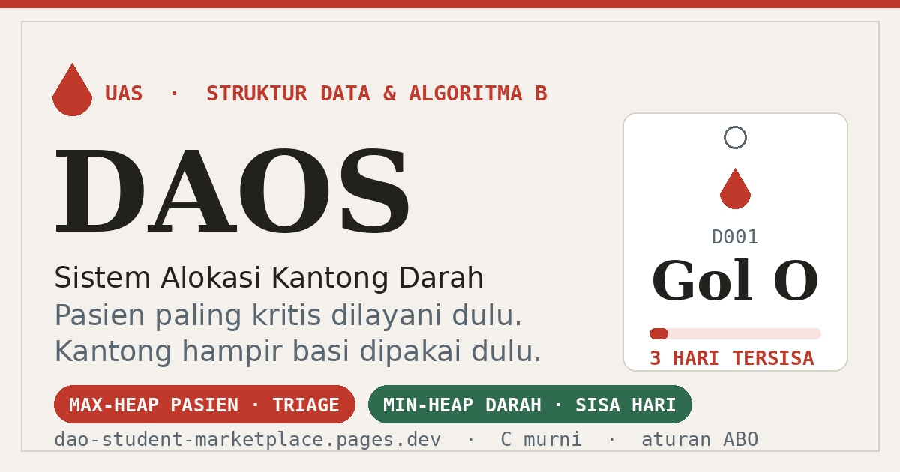

# DAOS — Sistem Alokasi Kantong Darah

> **Catatan nama repo:** `dao-student-marketplace` adalah nama repo yang
> menyesatkan — isinya **bukan** marketplace mahasiswa. Program ini adalah
> **Sistem Alokasi Kantong Darah (DAOS, SDG 3)** untuk UAS Praktikum
> Struktur Data dan Algoritma B: antrean pasien Max-Heap berdasarkan
> triage, stok darah Min-Heap berdasarkan sisa hari, alokasi dengan
> Linear Search + Greedy dan aturan kompatibilitas ABO. Tidak ada fitur
> jual-beli di repo ini, dan README ini tidak mengarangnya.
>
> Live: https://dao-student-marketplace.pages.dev/ (landing etalase)

Program CLI bahasa C murni (in-memory, tanpa database, tanpa jaringan)
yang mengoptimalkan distribusi darah: pasien paling kritis dilayani
dulu, dan kantong yang paling cepat kedaluwarsa dipakai dulu — supaya
tidak ada darah yang terbuang sia-sia.



## Cara build & jalan

Persyaratan: `gcc` (diuji 13.3.0) dan `make`. Tanpa dependensi lain.

```sh
make            # menghasilkan binary ./daos
./daos          # masuk menu utama
```

Tanpa make:

```sh
gcc -Wall -Wextra -std=c11 -O2 -o daos src/main.c src/uas.c
```

Menu utama:

```
[1] Input Data Pasien
[2] Input Kantong Darah
[3] Eksekusi Alokasi Darah
[4] Tampilkan Antrean Pasien & Stok Darah
[5] Tampilkan Riwayat Transaksi
[0] Keluar
```

## Cara kerja (singkat)

| Bagian | Struktur | Kunci |
|---|---|---|
| Antrean pasien | Max-Heap | triage terkecil dulu (1 = KRITIS EKSTREM); seri diputus status darurat |
| Stok darah | Min-Heap | sisa hari terkecil dulu (paling cepat kedaluwarsa dipakai dulu) |
| Alokasi | Linear Search + Greedy | cari semua kantong kompatibel (ABO), pilih sisa hari terkecil |

Aturan kompatibilitas ABO: AB terima semua; A terima A/O; B terima
B/O; O hanya terima O. Rhesus (+/−) tidak dimodelkan.

## Sesi contoh (data fiktif — nama pasien bukan orang nyata)

```sh
make demo   # sama dengan: ./daos < scripts/demo-input.txt
```

Skenario: 3 pasien (Budi Santoso O triage 1 darurat; Ayu Lestari B
triage 2; Citra Dewi A triage 4) dan 3 kantong (O 3 hari; B 30 hari;
A 12 hari). Potongan output **asli** (verbatim, dari satu kali jalan
dengan gcc 13.3.0 — output lengkap 162 baris di
[`docs/contoh-sesi.txt`](docs/contoh-sesi.txt)):

```
  Pasien Prioritas Tertinggi: Budi Santoso (Gol: O)
------------------------------------------------------------
  [SUKSES] Kantong D001 dialokasikan ke Pasien P002.

  Pasien Prioritas Tertinggi: Ayu Lestari (Gol: B)
------------------------------------------------------------
  [SUKSES] Kantong D002 dialokasikan ke Pasien P001.

  [ANTREAN PASIEN]
  1. P003 | Citra Dewi | Gol: A | Triage: 4 | Darurat: Tidak

  [STOK KANTONG DARAH]
  1. D003 | Gol: A | Sisa: 12 hari

  RIWAYAT TRANSAKSI
  #001 | Pasien: Budi Santoso -> Darah: D001
  #002 | Pasien: Ayu Lestari -> Darah: D002

  Program dihentikan. Total transaksi: 2.
```

Budi (triage 1 + darurat) dilayani pertama dan mendapat kantong O
3 hari; Ayu mendapat kantong B 30 hari; Citra dan kantong A 12 hari
tersisa menunggu.

## Struktur repo

```
├── src/
│   ├── main.c           # entry point + loop menu CLI
│   ├── uas.c            # heap, alokasi, menu input/tampil
│   └── uas.h            # struct, konstanta, prototipe
├── docs/
│   ├── PRD.md           # apa produk ini (dan apa yang bukan)
│   ├── ARCHITECTURE.md  # modul, algoritma, perilaku yang perlu diketahui
│   ├── USAGE.md         # cara pakai per menu
│   ├── TESTING.md       # smoke test + CI
│   ├── DEPLOY.md        # deploy Cloudflare Pages
│   ├── DESIGN.md        # kontrak arah desain landing
│   ├── diagrams.html    # diagram arsitektur (HTML+SVG)
│   ├── contoh-sesi.txt  # output demo verbatim
│   ├── CHANGELOG.md
│   └── Kelompok2_PPTUTS_B.pdf   # slide presentasi UAS (asli, tidak diubah)
├── scripts/
│   ├── demo-input.txt   # input sesi contoh
│   └── smoke-test.sh    # smoke test (dipakai `make test`)
├── index.html / styles.css / app.js   # landing statis (etalase)
├── og-image.png / favicon.svg
├── Makefile
└── README.md
```

## Testing

```sh
make test   # 6 kelompok assert atas output program — bukan echo sukses
```

Yang diuji: sesi demo penuh (2 alokasi + sisa antrean/stok + riwayat),
alokasi saat kosong, aturan ABO (pasien O + stok A = GAGAL), validasi
golongan (X ditolak, A diterima), menu tidak valid, dan greedy
(kantong 5 hari dipilih sebelum kantong 40 hari). CI
(`.github/workflows/ci.yml`, 5 job) menjalankan build-test, validasi
HTML + gate P0/OG, advisory-sweep OSV, e2e Playwright, dan smoke repo.
Detail: [`docs/TESTING.md`](docs/TESTING.md).

## Pembagian tugas & modul (sesuai arahan commit)

1. **Muhammad Rizki** (250810701100049) — struktur Queue/Heap pasien
   (`enqueue`/`dequeue` pasien, `swap` + `heapify` heap), integrasi
   menu utama.
2. **Siti Fildzahra Revani** (250810701100107) — struct fundamental &
   variabel global, sorting/heap darah (`swap` + `heapify` darah),
   menu tampilkan data.
3. **Nabil Aulia Dika** (250810701100090) — logika prioritas pasien,
   kompatibilitas golongan darah & input, konfigurasi sistem/header,
   menu alokasi.
4. **Irvan Almidar** (250810701100085) — Queue inventaris darah
   (`enqueue`/`dequeue` darah), pencarian & eksekusi alokasi, menu
   input & riwayat.

## Batasan yang perlu diketahui

- Semua data in-memory: keluar program = data hilang. Tidak ada
  penyimpanan permanen, login, atau jaringan.
- Tampilan antrean menunjukkan urutan array heap, bukan urutan terurut
  penuh — itu memang tujuan menunya (membuktikan heap berjalan).
- Pasien darurat langsung ke root saat enqueue, tapi triage tetap
  dominan saat heapify-down (lihat `docs/ARCHITECTURE.md`).

## Lisensi

MIT — lihat [`LICENSE`](LICENSE).
